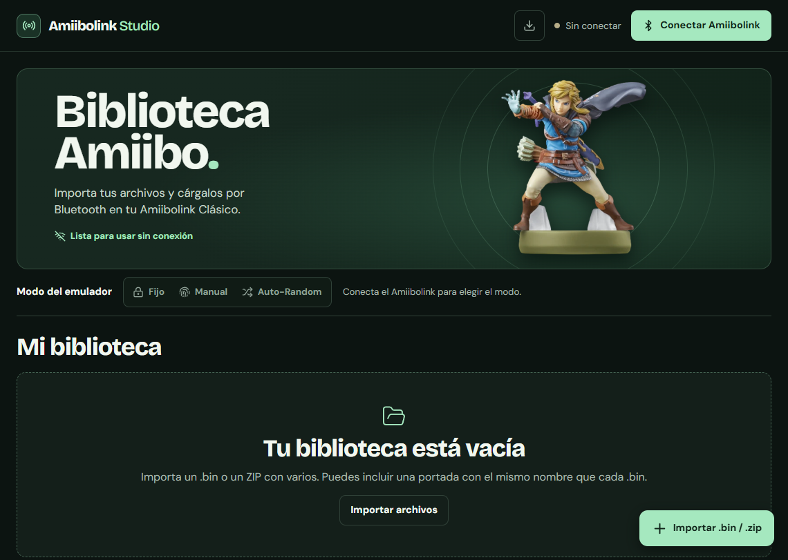
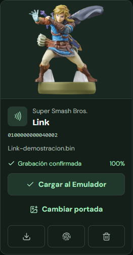
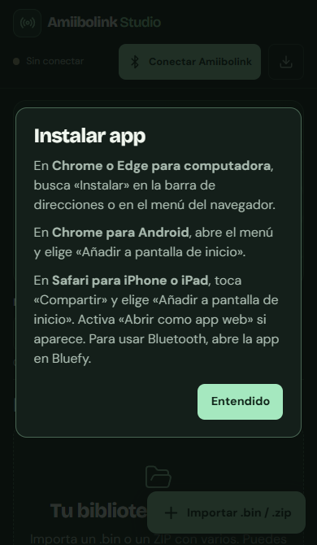

# Amiibolink Studio

Importa, organiza y carga tus archivos Amiibo en un **Amiibolink Clásico** (modelo con botón y LED) por Bluetooth. La app guarda la biblioteca y las portadas en tu navegador y puede abrirse sin internet después de la primera visita.

**[Abrir Amiibolink Studio en GitHub Pages](https://dufyzy.github.io/Amiibolink/)**

[Primeros pasos](#primeros-pasos) · [Instalar la app](#instalar-la-app) · [Biblioteca y portadas](#biblioteca-y-portadas) · [Desarrollo](#desarrollo)

## Primeros pasos

### Qué necesitas

- Un **Amiibolink Clásico** y un dispositivo con Bluetooth activado para transferir archivos.
- Tus propios volcados Amiibo NTAG215 o archivos que tengas permiso de usar. Puedes importar `.bin` de 532, 540 o 572 bytes y archivos `.zip` con varios volcados, incluso en subcarpetas.
- Un navegador compatible para conectar el emulador.

| Dispositivo | Navegador para usar Bluetooth |
| --- | --- |
| Computadora | Chrome o Edge con Web Bluetooth disponible en el sistema |
| Android | Chrome |
| iPhone o iPad | Bluefy, con permiso de Bluetooth |

En iPhone y iPad, Safari, Chrome y el acceso directo creado desde Safari permiten usar la biblioteca. Abre GitHub Pages en Bluefy para comunicarte con el emulador. [Web Bluetooth en Chrome](https://developer.chrome.com/docs/capabilities/bluetooth) · [Guía de Bluefy](https://bluefy.app/guide.html) · [Web Bluetooth en WebKit](https://bugs.webkit.org/show_bug.cgi?id=238049)

### Cómo cargar un Amiibo

1. Abre la app y pulsa **Importar .bin / .zip**, abajo a la derecha. Selecciona tus archivos. Las fichas aparecerán en **Mi biblioteca**.
2. Pulsa el botón físico del Amiibolink para activarlo. En la cabecera, pulsa **Conectar Amiibolink** y selecciona el emulador en el panel del navegador.

   

3. En la ficha del Amiibo, pulsa **Cargar al Emulador** y espera a que indique **Grabación confirmada** al 100 %. Después acerca el emulador al lector NFC de tu consola para comprobarlo.

   

   *La captura de carga usa un archivo de demostración y un emulador simulado.*

### Modos del emulador

- **Fijo** conserva el identificador único (UID) en el modo de lectura y escritura del firmware compatible. Selecciónalo antes de cargar el archivo.
- **Manual** conserva el UID entre lecturas y lo cambia al pulsar el botón físico.
- **Auto-Random** cambia el UID al escanear.

El modo se marca como activo cuando el emulador lo confirma. Si una transferencia se interrumpe, revisa **Consola BLE**, donde aparecen los envíos (`TX`) y las respuestas (`RX`). Vuelve a conectar antes de reintentar.

## Instalar la app

Pulsa el **icono de descarga** en la cabecera para instalar la app o crear un acceso directo. Si el navegador ofrece un diálogo de instalación, se abrirá directamente. En los demás casos, verás los pasos para hacerlo desde el menú del navegador.



En iPhone o iPad, abre la página en Safari y elige **Compartir → Añadir a pantalla de inicio**. Si aparece **Abrir como app web**, actívalo. Para transferir por Bluetooth, usa Bluefy. [Guía de Apple](https://support.apple.com/es-es/guide/iphone/iphea86e5236/ios)

La primera visita requiere internet. Cuando aparezca **Lista para usar sin conexión**, podrás volver a abrir la app con los archivos y portadas guardados. La biblioteca queda en el perfil del navegador y en la dirección donde la creaste. Conserva una copia de tus `.bin` si vas a cambiar de navegador, usar otro dominio o borrar los datos del sitio.

## Biblioteca y portadas

- **Organiza tus archivos.** Busca por nombre, nombre de archivo o ID y filtra por juego o serie. La app identifica cada Amiibo con los metadatos integrados, detecta duplicados por contenido y permite descargar el `.bin` en su tamaño original.
- **Añade una portada.** Usa **Añadir portada** en la ficha o importa juntos archivos con el mismo nombre, como `Link.bin` y `Link.png`. Dentro de un ZIP, colócalos en la misma carpeta. Se admiten JPG, PNG y WebP de hasta 8 MiB por imagen y 64 MiB por lote.
- **Completa las portadas en línea.** Pulsa **Buscar portadas en AmiiboAPI** para buscar las que falten. Puedes detener la búsqueda y retomarla. Las portadas guardadas siguen disponibles sin conexión. [AmiiboAPI](https://github.com/8bitDream/AmiiboAPI)

Al importar, los archivos auxiliares `key_retail.bin`, `locked-secret.bin`, `unfixed-info.bin` y `ally-all-in-*.bin` se cuentan como omitidos. Usa volcados individuales para las fichas de la biblioteca.

### Generar un UID nuevo

En una ficha, pulsa el icono de huella y selecciona tu propio `key_retail.bin` de 160 bytes, con `unfixed-info` seguido de `locked-secret`. La app verifica las firmas del original, genera un UID NXP, recalcula BCC0 y BCC1 y guarda una copia de 540 bytes cifrada y firmada. El archivo original se conserva y las claves se procesan en memoria.

## Desarrollo

Con Node.js 22.12 o posterior y npm, ejecuta estos comandos desde la raíz del repositorio.

```sh
npm ci
npm test
npm run build
npm run preview
```

Abre [http://localhost:4173](http://localhost:4173) en Chrome o Edge. Para probar la caché, espera **Lista para usar sin conexión**, activa el modo sin red en DevTools y recarga. Usa `npm run dev` al trabajar en la interfaz y la compilación de producción para probar el service worker.

El sitio oficial se publica automáticamente al subir cambios a `main`. [Flujo de GitHub Actions](.github/workflows/pages.yml)

| Ruta | Contenido |
| --- | --- |
| `src/components/` | Cabecera, fichas, diálogos y consola BLE |
| `src/hooks/usePwa.ts` y `vite.config.ts` | Instalación, manifiesto y caché sin conexión con Workbox |
| `src/services/importFiles.ts`, `dbStorage.ts` y `catalog.ts` | Importación, IndexedDB e identificación de Amiibo |
| `src/services/amiibolinkBleService.ts` y `amiibolinkProtocol.ts` | Conexión Bluetooth, transferencia y verificación de respuestas |
| `src/services/ntag215Utils.ts` y `amiiboCrypto.ts` | Formato NTAG215, UID y firma |

<details>
<summary>Probar la app en Bluefy desde la red local</summary>

Si una IP local muestra una página en blanco en Bluefy, prueba primero la misma URL HTTPS en Safari. Para un certificado emitido por una autoridad local, instala su perfil en iOS y activa la confianza para SSL. Cuando cargue la página, revisa el permiso de Bluetooth de Bluefy en **Ajustes → Privacidad y seguridad**. La publicación de GitHub Pages ya tiene un certificado público. [Confianza de certificados en iOS](https://support.apple.com/es-es/102390) · [Permisos del iPhone](https://support.apple.com/es-mx/guide/iphone/iph168c4bbd5/ios)

</details>

<details>
<summary>Detalles del protocolo Amiibolink Clásico</summary>

El cliente encuentra el emulador por el prefijo `amiibolink` o por el servicio Nordic UART (`6e400001…`). Antes de escribir en `6e400002…`, se suscribe a las notificaciones de `6e400003…`. Cada trama espera una confirmación (ACK) antes de pasar a la siguiente.

| Etapa | TX | ACK esperado |
| --- | --- | --- |
| Preparación | `A0 B0` | `B0 A0` |
| Longitud | `AC AC 00 04 00 00 02 1C` | `CA CA` |
| Confirmación de longitud | `AB AB 02 1C` | `BA BA` |
| 27 bloques con índices del 1 al 27 | `DD AA 00 14` + 20 bytes + índice de 16 bits BE | `AA DD` |
| Fin de datos | `BC BC` | `CB CB` |
| Grabación | `CC DD` | `DD CC` |

Para la transferencia, los archivos de 532 bytes se completan con ocho ceros y los de 572 bytes se recortan a 540. Cada trama de datos de 26 bytes se envía en una escritura GATT. Si el adaptador rechaza el tamaño o falta una confirmación, la consola indica dónde se detuvo la operación.

Los comandos de modo V2 cifran `A1 B1 03` (Fijo), `A1 B1 01` (Manual) y `A1 B1 04` (Auto-Random). El cliente acepta ACK en claro o envueltos en V2. Las pruebas del repositorio usan un periférico simulado. La grabación en memoria flash y el comportamiento de NFC y LED se comprueban en el dispositivo físico. [Cliente WebBluetooth Clásico](https://github.com/DanTheMan827/amiibolink-amiloop-webbluetooth/blob/master/amiibolink.html) · [Capturas de Pixl.js](https://github.com/solosky/pixl.js/blob/main/docs/en/05%2B2-amiibolink_ble.md) · [Implementación de Pixl.js](https://github.com/solosky/pixl.js/blob/main/fw/application/src/app/amiibolink/scene/amiibolink_scene_main.c)

</details>

## Licencia

El código se publica bajo la [licencia MIT](LICENSE). Consulta los [créditos y avisos de terceros](THIRD_PARTY.md).
